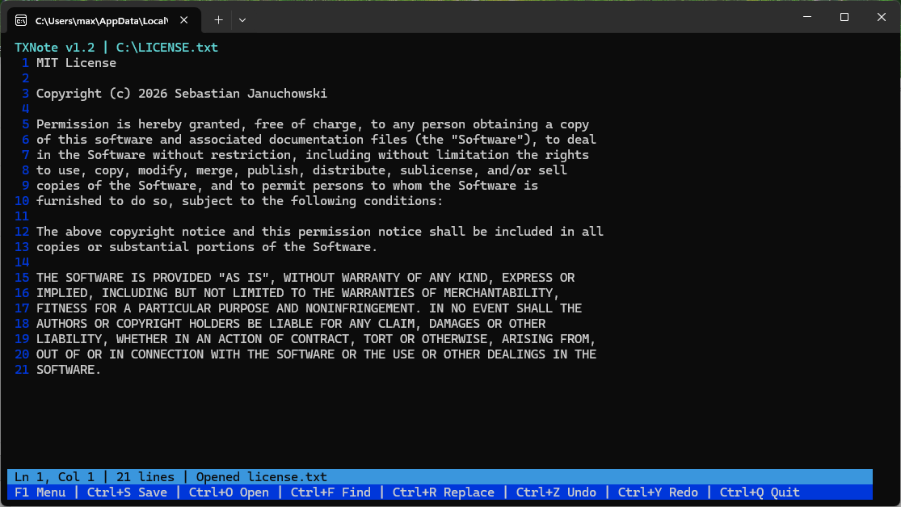

# TXNote v1.2

<p align="center">
  <strong>A lightweight, elegant curses-based text editor for the terminal.</strong>
</p>

<p align="center">
  <a href="https://www.python.org/"></a>
  <a href="LICENSE.txt"></a>
  
  
  
</p>

---

## 📸 Screenshot

<p align="center">
  
</p>

---

## 📖 Overview

**TXNote v1.2** is a compact, distraction-free terminal text editor built in Python using the `curses` library. Originally designed for **TerminalX Navigator**, TXNote delivers a modern Text User Interface (TUI) with line numbering, interactive search and replace, multi-level undo/redo, modal dialogs, and comprehensive keyboard navigation—all without heavy dependencies.

---

## ✨ Features

- 🖥️ **Sleek Curses Interface:** Customized color scheme, status bar, and real-time cursor position tracking.
- 📜 **Line Numbering:** Toggleable line numbers with syntax-friendly spacing.
- 🔍 **Find & Replace:** Instant search with highlighted matches, forward navigation, and full string replacement.
- ↩️ **Undo & Redo:** History snapshot stack allowing up to 100 levels of undo/redo operations.
- 📋 **Interactive Menu (`F1`):** Quick-access dropdown menu for all editor commands.
- 📑 **File Management:** Seamlessly load, edit, save, and "save as" UTF-8 encoded files.
- ⚡ **Productivity Shortcuts:** Duplicate lines, jump directly to line numbers, and fast page scrolling.
- 🪶 **Zero Heavy Dependencies:** Relies purely on the Python standard library.

---

## ⌨️ Keyboard Shortcuts

| Shortcut | Description |
| :--- | :--- |
| **`F1`** | Open interactive command menu |
| **`Ctrl + S`** | Save current file |
| **`Ctrl + O`** | Open a file from path |
| **`Ctrl + F`** | Find text in document (highlights matches) |
| **`Ctrl + R`** | Find and replace text |
| **`Ctrl + G`** | Go to line number |
| **`Ctrl + D`** | Duplicate current line |
| **`Ctrl + Z`** | Undo last change |
| **`Ctrl + Y`** | Redo last change |
| **`Ctrl + L`** | Toggle line numbers on / off |
| **`Ctrl + Q`** | Quit editor (prompts to confirm if modified) |
| **`Arrow Keys`** | Move cursor up, down, left, right |
| **`Home` / `End`** | Jump to beginning or end of line |
| **`PgUp` / `PgDn`** | Scroll page up or down |
| **`Tab`** | Insert 4 spaces indentation |

---

## 🚀 Getting Started

### Prerequisites

- **Python 3.8+**
- Curses library support:
  - **Linux / macOS:** Built into the Python standard library.
  - **Windows:** Requires `windows-curses` package.

### Installation

1. **Clone the repository:**
   ```bash
   git clone https://github.com/polsoft-it/TXNote.git
   cd "TX-Note v1.2"
   ```

2. *(Windows only)* **Install `windows-curses`:**
   ```bash
   pip install windows-curses
   ```

### Running the Editor

- **Open a new blank document:**
  ```bash
  python TXNote.py
  ```

- **Open an existing file (or create new with name):**
  ```bash
  python TXNote.py path/to/file.txt
  ```

---

## 📂 Project Structure

```text
TX-Note v1.2/
├── TXNote.py         # Main application source code
├── description.txt   # Short project summary
├── LICENSE.txt       # MIT License
├── README.md         # Documentation & guide
└── screenshot.png    # Application screenshot preview
```

---

## 👤 Author & Credits

- **Author:** Sebastian Januchowski
- **Organization:** polsoft.ITS™
- **Email:** [polsoft.its@mail.com](mailto:polsoft.its@mail.com)
- **GitHub:** [@polsoft-it](https://github.com/polsoft-it)

---

## 📄 License

This project is licensed under the **MIT License** - see the [LICENSE.txt](LICENSE.txt) file for details.
